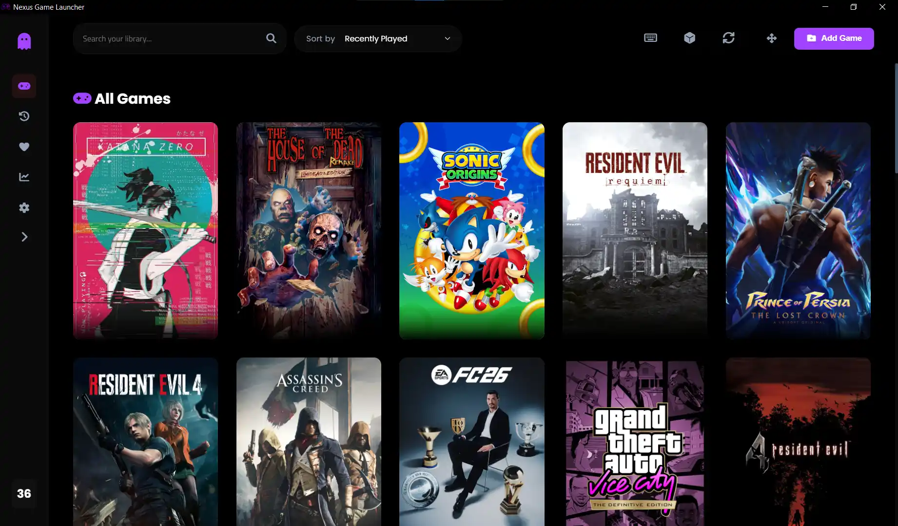
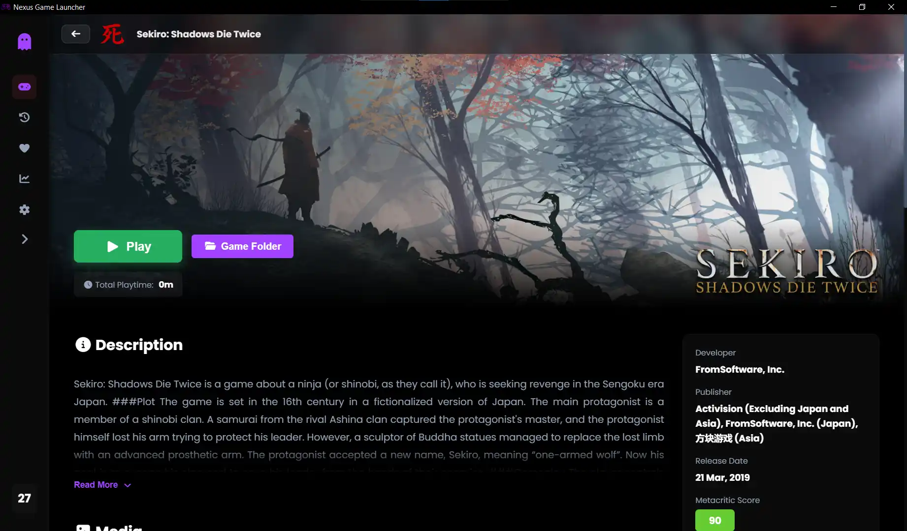
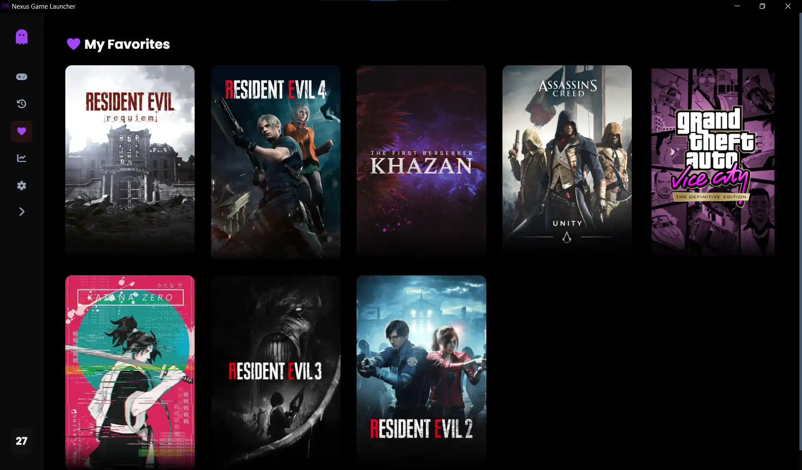
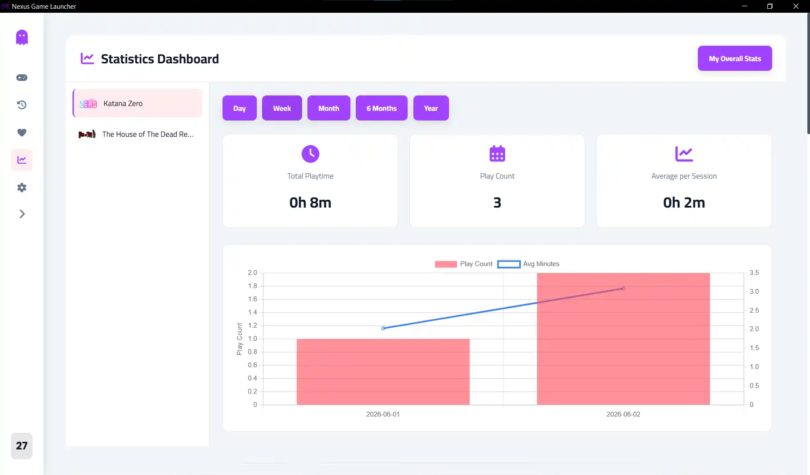
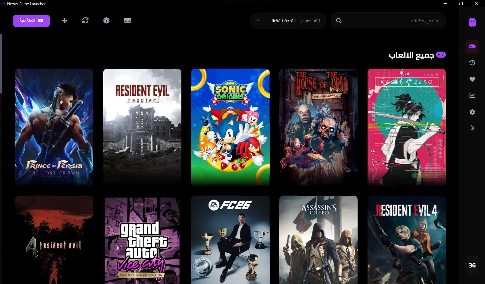

<div align="center">


# Nexus Game Launcher

**Your PC game library, launch controls, artwork, playtime, and save backups — in one desktop app.**

[](package.json)
[](https://www.electronjs.org/)
[](#platform-support)
[](#appearance-and-localization)

[**Features**](#features) · [**Screenshots**](#screenshots) · [**Getting started**](#getting-started) · [**Save backups**](#game-save-backups) · [**Overlay status**](#experimental-in-game-modal-overlay) · [**Development**](#development-and-builds)



*A locally managed game launcher built with Electron, Node.js, HTML, CSS, and JavaScript.*

</div>

> [!NOTE]
> **Source version: 2.8.1.** This maintenance hotfix keeps the v2.8.0 features and fixes Settings scroll/focus behavior when changing Modal Overlay options. A downloaded installer may not yet include every feature described here. Check [Releases](https://github.com/AliAl-ojeely/nexus-game-launcher/releases) for the features and assets of a particular published build.
>
> Some screenshots in this repository were captured from earlier interface revisions; the application UI may now look different.

## At a glance

| Area | What Nexus provides |
| --- | --- |
| **Library** | Add and launch games, search, favorites, manual ordering, Recently Added, Recently Played, and playtime sorting. |
| **Game details** | Artwork, descriptions, screenshots, trailers, system requirements, notes, and an updated two-column Add/Edit Game modal. |
| **Artwork** | RAWG metadata, Steam information, SteamGridDB artwork, local cache, and manual poster/background/logo/icon overrides. |
| **Statistics** | Session history and charts with day-to-year filters, CSV session export, and PNG dashboard export. |
| **Game saves** | Manual/optional automatic backups, consent-based save-path discovery, an optional bounded deep scan, restore safeguards, and Backup Vault tools. |
| **Personalization** | English and Arabic (RTL), Dark/Darker/Light themes, accent colors, configurable Settings, and other local preferences. |
| **In-game overlay** | **Experimental, Windows-only, and off by default**; restricted to suitable offline games without anti-cheat. |

## Screenshots

<table>
  <tr>
    <td align="center"><br /><strong>Game details</strong></td>
    <td align="center"><br /><strong>Favorites</strong></td>
  </tr>
  <tr>
    <td align="center"><br /><strong>Statistics</strong></td>
    <td align="center"><br /><strong>Arabic interface</strong></td>
  </tr>
</table>

For the current modal layout, see [`css/game-modal-split-v011.css`](css/game-modal-split-v011.css). The repository does not yet contain an updated screenshot of that modal.

## Features

### Game library and details

- Add games and manage local launch targets, launch arguments, and installation status.
- Find games using search, collect favorites, and organize cards using drag-and-drop manual order.
- Sort by name (A–Z/Z–A), playtime, **Recently Played**, or **Recently Added**.
- **Recently Added** uses the saved library insertion order, rather than assuming the game's numeric ID is its creation date. This also handles games added again with older restored IDs.
- Open a game details page for artwork, description, developer/publisher, release date, supported system requirements, screenshots, trailers, playtime, and personal notes.
- Use the responsive **two-column Add/Edit Game modal**: game name, executable, installation status, original save path, backup location, and launch arguments on the left; poster, logo, background, and icon overrides on the right. The original button icons and behavior are preserved.
- Store game-library preferences and notes locally.

### Artwork and metadata

Nexus combines multiple providers, but **does not assume that every game has a Steam AppID**:

1. **RAWG** supplies game metadata, release information, and media when available.
2. **Steam** supplies verified store identity and related artwork when a suitable AppID is available.
3. **SteamGridDB** supplies poster/grid, hero/background, logo, and icon artwork. Its fallback lookup can use a **canonical title and release year** for games without a Steam AppID.
4. Existing valid images and manual artwork are retained instead of being erased by an unsuccessful refresh.

Art selection is conservative: identity checks reject ambiguous results, mismatched release years, sequels, films, soundtracks, and unrelated titles. Downloaded images are checked for supported formats and dimensions before they are saved. Screenshots and trailer media are handled separately from library artwork.

The SteamGridDB identity improvement was verified with **Dante's Inferno (2010)**, for which the poster, background, logo, and icon were successfully downloaded during local testing. This is an example, **not a guarantee that artwork is available for every title**.

Use **Refresh Assets** from a game's details page to retry retrieval without deleting and re-adding the game. An optional **SteamKit2/PICS logo fallback** exists in Settings, but requires a verified Steam identity and a separately available helper; its release packaging/runtime remains unverified.

### Game statistics and sessions

- Total playtime, session count, average session duration, and per-game/overall views.
- Time filters for **Day**, **Week**, **Month**, **6 Months**, and **Year**.
- Session history, daily and monthly charts, weekday/hour patterns, and top-played games.
- Export session data to **CSV** or the current dashboard to **PNG**.
- Independent concurrent sessions: each game has its own timer, pause/resume state, and Play/Stop controls. Closing one game does not end another.
- Restart-aware process monitoring: eligible natural exits use a balanced four-second guard, while uncertain exits retain extended protection. A verified replacement detected within the guard continues the existing session.
- Configurable Recently Played limits, with an option to remove an item from the recent list without deleting the game itself.

### Appearance and localization

- English and Arabic interfaces, including RTL layout for Arabic.
- Dark, Darker, and Light appearance options, configurable accent colors, and library layout preferences.
- Collapsible navigation sidebar and a section-based Settings page: **General**, **Appearance**, **Modal Overlay**, and **Backup & Vault**.
- Hover and transition styling, including the dedicated Backup button hover polish.
- Local preferences such as window dimensions, updates, and system-tray behavior.

## Game save backups

Nexus provides save-file backup utilities, **not a universal game-save detector**. Supported games and save layouts vary.

### Discovering a save path

- **Discover Save Location** previews candidates before the user chooses one. Discovery does not automatically bind an unconfirmed path.
- Lookup sources include the bundled path database, refreshed **Ludusavi-compatible** manifest data, common Windows save layouts, Unity `LocalLow`, and supported Steam-related locations when identity evidence is available.
- **Extended save search** is optional and bounded. It distributes work across candidate roots and reports partial coverage when depth, child-count, time, directory budgets, or read errors prevent full inspection.
- **Observe next game session** and **scan a chosen folder or drive** are additional explicit opt-in discovery tools.
- Safety checks reject overly broad locations and entire game-installation folders as save roots, while allowing appropriately narrow save folders.

### Creating and restoring backups

- Make a backup manually with **Backup Now**, or enable optional automatic backups for configured games.
- Choose a global Backup Vault location or a per-game backup destination.
- Inspect available backups and restore a selected version with safety checks.
- Archive validation, Vault integrity checks, and guarded deletion/restoration help avoid unsafe operations; no backup system is a substitute for an independently verified save copy.
- Save data and backup preferences stay separate from the game's executable and metadata.

> [!IMPORTANT]
> Verify the **original save path** before creating a backup. A discovery result may be incomplete or ambiguous. Keep an independent copy of valuable saves before testing restoration. The current model uses a single confirmed `originPath` per game; multi-location `originPaths[]` support is **not implemented yet**.

For troubleshooting, use the terminal diagnostics available through `NEXUS_BACKUP_LOG_LEVEL=debug`. They report scan coverage and status while masking sensitive paths in the relevant diagnostic output.

## Experimental in-game Modal Overlay

> [!WARNING]
> **Experimental, Windows-only, off by default.** Use only in suitable **offline games without online anti-cheat**. Compatibility depends on the game, architecture, graphics API, and display mode. An installer successfully building is **not** proof of compatibility with a particular game.

The **Settings → Modal Overlay** editor provides:

- A redesigned live preview and grouped settings, with **Dockline**, **Corner Pulse**, **Side Rail**, and **Command Strip** designs.
- Four screen corners, **Full / Medium / Mini Display** modes, and independent **Small / Large** window sizes.
- Optional **Session Time**, **Total Playtime**, **Local Time**, and **FPS** fields. FPS stays `N/A` until the application has a verified value.
- **Resume Game** (closes the Nexus dashboard) and **Pause/Resume Timer** (controls the *Nexus playtime timer*, not the game's pause state).
- Glassy, Solid, and Minimal backgrounds, launcher theme colors, color/opacity controls, and a configurable keyboard shortcut.
- Foreground-aware shortcut routing for multiple running games, optional Esc / Start quick toggles, and separate keyboard/controller navigation switches.
- Optional automatic Nexus timer pause/resume when opening and closing the overlay; manually paused sessions are protected.

A verified replacement process detected during Restart Guard keeps the same session. Delayed restarts outside the guard may still end the session; known restart-sensitive games can use `NEXUS_RESTART_GUARD_GAME_IDS` for extended protection.

| Graphics API | Development status |
| --- | --- |
| DirectX 9 | Experimental support in tested games |
| DirectX 10 | Not independently verified as a separate backend |
| DirectX 11 | Experimental support in tested games |
| OpenGL | Experimental support in tested games |
| DirectX 12 | **Incomplete / disabled under safety restrictions** |
| Vulkan | Not verified |

The Windows GitHub Actions workflow contains steps to build and verify Windows x86/x64 overlay runtime resources outside `app.asar`. **Local packaging is different**: `npm run dist-win` alone may warn that `build/overlay-runtime` is missing if those native components have not been staged first. The Windows ARM64 overlay runtime is not supported. See the [v2.7.6 release notes](.github/release-notes/v2.7.6.md) for packaging context.

## Platform support

| Platform | Status and notes |
| --- | --- |
| **Windows** | Primary development platform. NSIS build targets include x64 and ARM64; the native overlay has separate architecture restrictions. |
| **Linux** | AppImage build targets include x64 and ARM64. Supported Windows games can be launched through a locally configured **Proton** setup; compatibility depends on the game and installed libraries. |
| **macOS** | A universal DMG build target exists in CI. This **does not imply Windows game/Proton support or feature parity**. |

On Linux, the existing launch implementation looks for a compatible Proton executable at `~/Nexus-Proton/GE-Proton10-32/proton`. Install Proton and appropriate graphics/audio dependencies for your Linux distribution before attempting to launch Windows games. The experimental in-game overlay is **not** a Linux feature.

## Getting started

### Download an installer

Check the [GitHub Releases page](https://github.com/AliAl-ojeely/nexus-game-launcher/releases) for published downloads. Availability, architecture, and bundled experimental components depend on the release. Prefer published assets over assuming an arbitrary source checkout is a production build.

### Run from source

**Prerequisites:** Git and Node.js/npm. The repository's release workflow uses **Node.js 22**.

```bash
git clone https://github.com/AliAl-ojeely/nexus-game-launcher.git
cd nexus-game-launcher
npm ci
npm start
```

To run selected regression tests already tracked in the repository:

```bash
node --test tests/steamgrid-identity-v062.test.cjs tests/steamgrid-provider-v062.test.cjs tests/library-recently-added-v010.test.cjs tests/game-modal-split-v011.test.cjs
```

### Optional provider credentials

Development credentials are read from the ignored `src/secrets.json` file, or from environment overrides such as `NEXUS_SGDB_API_KEY`. Use [`secrets.json.example`](secrets.json.example) as a starting point. A packaged application uses its own per-user `provider-secrets.json` under Electron's `userData` directory. Keys are **not** bundled into release installers.

Do not commit API keys, local game saves, personal databases, or user configuration files. Missing provider credentials can reduce the available artwork/metadata sources.

## Development and builds

| Command | Purpose |
| --- | --- |
| `npm start` | Launch the development application. |
| `npm run dist-win` | Build configured Windows NSIS targets (requires relevant staged resources for full overlay packaging). |
| `npm run dist-linux` | Build configured Linux AppImage targets. |
| `npm run dist` | Run `electron-builder` with the package's build configuration. |
| `npm run overlay:doctor` | Inspect the experimental overlay environment. |
| `npm run overlay:poc` | Launch the overlay proof-of-concept host. |

The [`release.yml`](.github/workflows/release.yml) workflow is **manually dispatched**. A normal `git push` does **not** automatically publish a release. It builds Windows/Linux/macOS artifacts, and publishing is gated on build success and release-asset checks. The CI workflow's overlay build and verification steps are specific to Windows.

### Selected source layout

```text
nexus-game-launcher/
├── .github/workflows/      # Release automation
├── .github/release-notes/  # Version-specific release notes
├── assets/                 # Existing screenshots, icons, fonts
├── css/                    # UI themes, layout, modal and Backup styling
├── modules/                # Game launching, artwork, saves, overlay, storage
├── native/nexus-overlay/   # Experimental native graphics bridge
├── overlay/poc/            # Experimental offscreen overlay UI and host
├── render/                 # Library, details, modal, settings, stats
├── src/ipc/                # Electron IPC handlers
├── src/main.js             # Electron main process entry point
├── src/preload.js          # Scoped renderer bridge
├── src/translations.js     # English and Arabic interface strings
├── tests/                  # Tracked regression tests
├── tools/                  # Development/diagnostic utilities
├── index.html              # Main application document
├── package.json
└── README.md
```

User preferences, local game-library data, cached artwork, and save-backup configuration are stored in the application's local data directory. Do not treat copies of JSON files in a checkout as a substitute for your actual Electron `userData` files.

## Known limitations and planned work

- Save discovery cannot recognize every game or every save location; bounded scans may finish with partial coverage.
- **Multi-location save origins** (`originPaths[]`) remain a future enhancement.
- Native in-game overlay support is experimental; **DirectX 12 is incomplete** and Vulkan has not been verified.
- The SteamKit2/PICS logo helper is opt-in and its runtime/release availability is not yet verified.
- Cross-platform build targets do not mean identical game-launch capabilities on Windows, Linux, and macOS.
- Security advisories and dependency updates should be reviewed before distributing new releases.

## Contributing and support

Bug reports and improvement suggestions are welcome through [GitHub Issues](https://github.com/AliAl-ojeely/nexus-game-launcher/issues). When reporting a problem, include the operating system, app version, reproducible steps, relevant error codes, and whether the issue occurs in a source build or published installer. **Do not upload game-save contents, credentials, private file paths, or personal data to public issues.**

**Maintainer:** [Ali Nasser Al-ojeely (Mr.Ghost)](https://github.com/AliAl-ojeely) · [Email](mailto:alialojeely@gmail.com)

> **Licensing note:** The repository currently does not include a standalone `LICENSE` file. Do not infer redistribution or reuse permissions from badges or this README; ask the maintainer for licensing terms.
