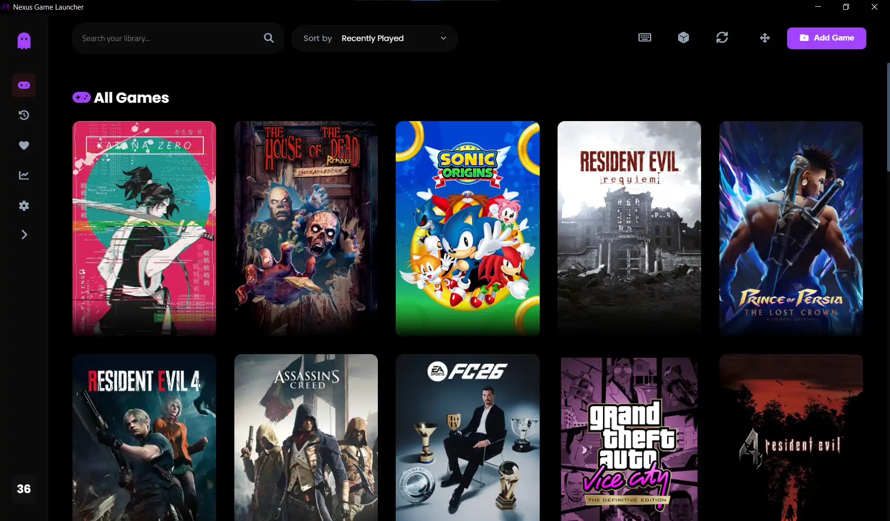
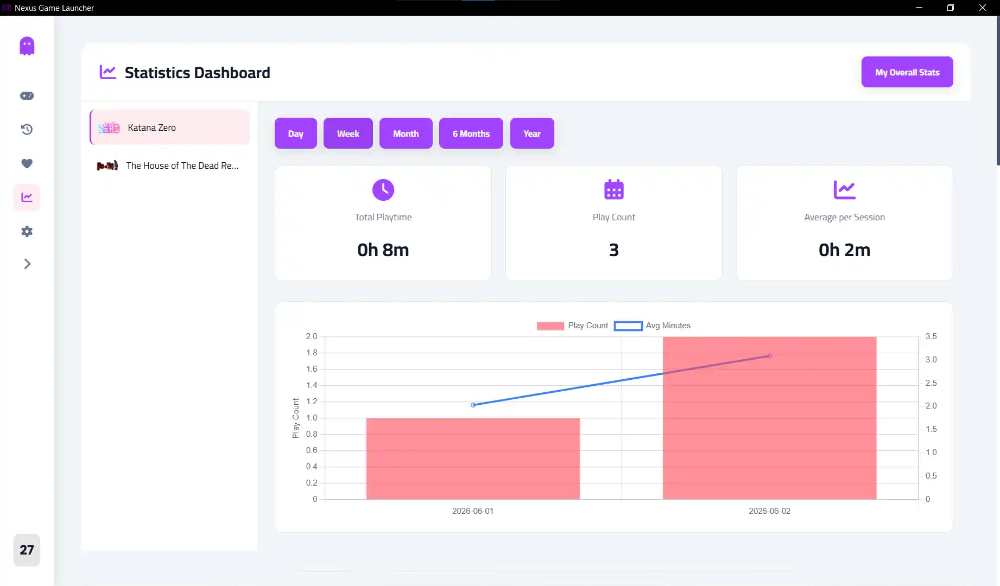
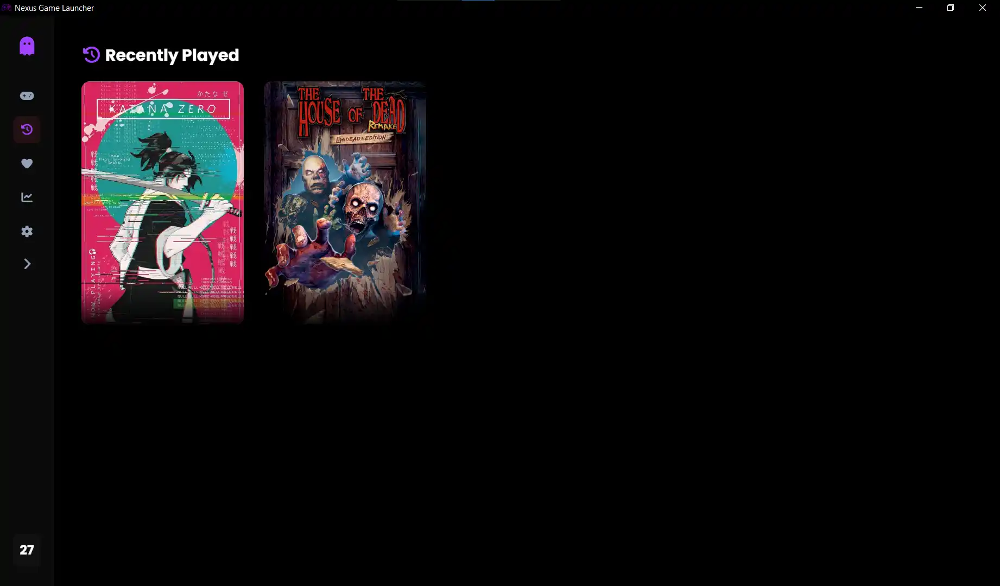
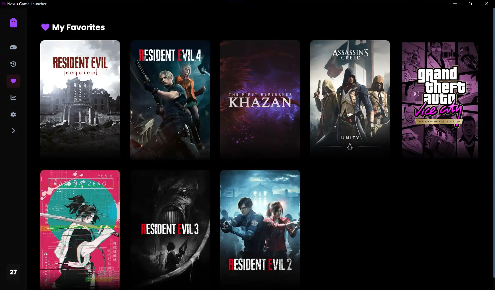
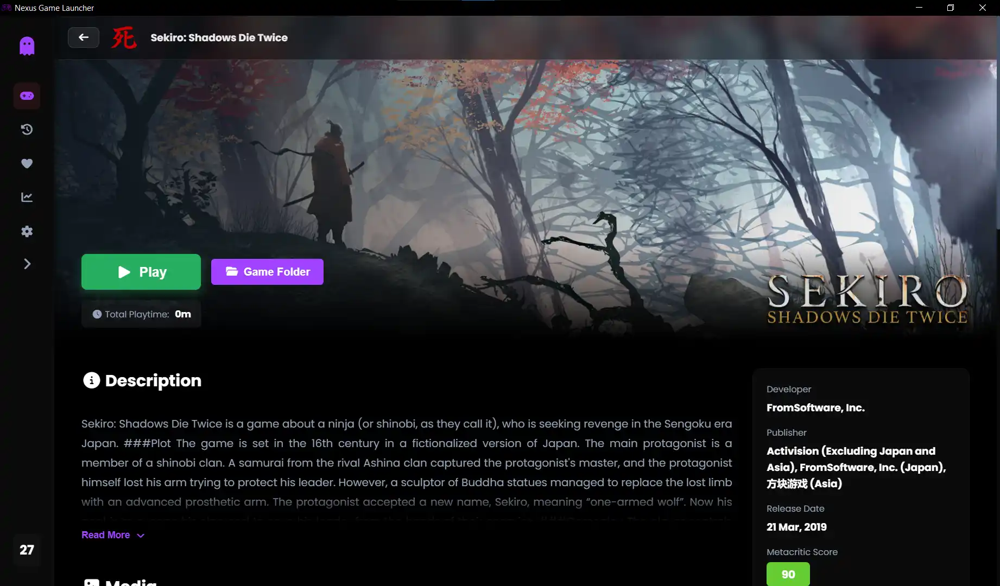
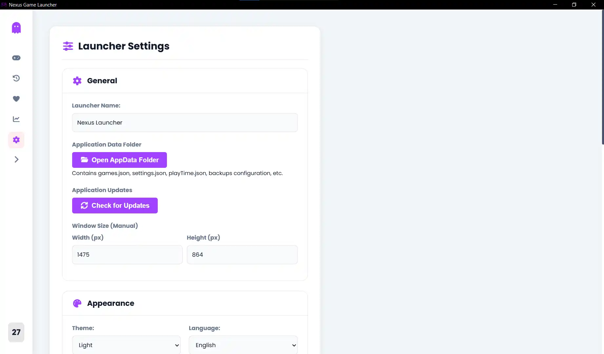
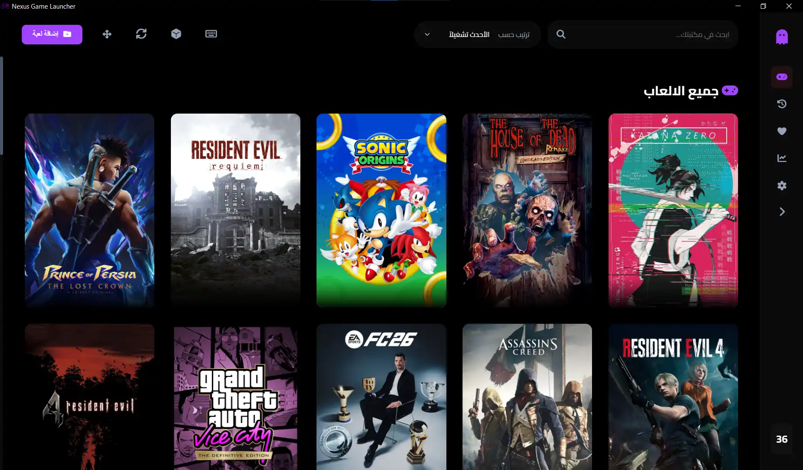

<div align="center">

# Nexus Game Launcher

[](https://www.electronjs.org/)
[](https://github.com/AliAl-ojeely/nexus-game-launcher/releases)
[](https://github.com/AliAl-ojeely/nexus-game-launcher)
[](https://github.com/AliAl-ojeely/nexus-game-launcher)
[](https://github.com/AliAl-ojeely/nexus-game-launcher)

<br>



<br>

**Nexus Game Launcher** is an Electron-based desktop application with a cinematic, organized interface for managing and launching locally installed PC games.

Windows is the primary platform. Since **v1.6.0**, Nexus has also supported running compatible Windows games on Linux through **Proton**.

</div>

---

## What's New in `v2.7.5` - Insight & Control + Experimental Overlay

The `v2.7.5` documentation brings together the Insight & Control improvements and the ongoing **in-game Modal Overlay** work. The overlay is **experimental**: its code and development previews should not be confused with a universally supported or release-ready in-game feature.

### Experimental In-Game Modal Overlay (Windows)

Nexus is developing a configurable, in-game dashboard for viewing session information and controlling the **Nexus playtime timer** without leaving a compatible game.

> [!WARNING]
> **Experimental - not fully supported.** Modal Overlay is under active development and may change significantly. It is intended for **offline games without anti-cheat**. Compatibility varies by game, graphics API, display mode, and system configuration. DirectX 12 support is **not complete**. Do not assume this feature works in a published installer simply because the application builds successfully.

The current development implementation includes:

- **Global opt-in:** Enable or disable the feature from **Settings > Modal Overlay**. The master switch is off by default.
- **Live preview:** The editor previews the actual `overlay/poc` HTML/CSS design, rather than a separate mockup.
- **Selectable metrics:** Session Time, Total Playtime, Local Time, and a Game FPS field. **Game FPS shows `N/A` when there is no verified frame-rate reading**.
- **Selectable actions:** Resume Game, Pause/Resume Timer, and an optional Test button, subject to the selected layout.
- **Three layout presets:** **Full**, **Medium**, and **Minimal**. Minimal retains **Resume Game**, **Pause/Resume Timer**, and the keyboard hints, while displaying the user's selected metrics.
- **Visual customization:** Glassy, Solid, or Minimal background style, background color, accent color, and opacity.
- **Editable keyboard shortcut:** `Ctrl + Shift + O` by default; supported alternatives can be recorded in Settings. A changed shortcut applies when a new game session starts, and may be unavailable if Windows or another application reserves it.
- **Local configuration:** Preferences are saved in the launcher's local `settings.json` under `modalOverlay`.

**Important control behavior:** **Resume Game** closes the Nexus dashboard; it does **not** unpause the game. **Pause/Resume Timer** affects Nexus's playtime accounting, not the game's own pause state.

**Graphics API progress (development tests, not a universal compatibility guarantee):**

| Graphics API | Status |
|:--|:--|
| DirectX 9 | Experimental support in tested games |
| DirectX 10 | Not independently verified as a separate backend |
| DirectX 11 | Experimental support in tested games |
| OpenGL | Experimental support in tested games |
| DirectX 12 | Incomplete; safety restrictions remain in place |
| Vulkan | No confirmed supported renderer |

The dashboard uses an offscreen Electron HTML renderer and a native graphics bridge. Its glass effect is **translucent rendering**, not a promise of real-time background blur of game pixels. The current render surface is `560 x 338` pixels, with an 8-pixel transparent margin and 18-pixel rounded widget corners. The Full, Medium, and Minimal layouts share that technical surface.

### Redesigned Settings

Settings now uses a wider, section-based layout instead of one long vertical page. It opens on **General** and provides four dedicated sections: **General**, **Appearance**, **Modal Overlay**, and **Backup & Vault**. Existing settings and their useful descriptions are retained. The launcher continues to support English and Arabic RTL interfaces.

### Game Statistics Dashboard

Explore your gaming history with:

- Total playtime, play count, and average session length, per game or overall.
- Day, Week, Month, 6 Months, and Year filters.
- Daily session charts, weekday and hourly distributions, top games, and monthly playtime charts.
- The 20 most recent sessions, with CSV export.
- PNG export of the current statistics view.

<p align="center">
  
</p>

### Library Sorting

Sort your library by name (A-Z or Z-A), total playtime, or most recent launch. Manual drag-and-drop ordering remains available.

### Personal Game Notes

Keep per-game notes such as completed difficulties or next-session goals. Notes are displayed in the game details view and stored locally.

### Folder Details in the Game Sidebar

Inspect a game's folder name, type, path, size, size on disk, file and folder counts, and creation date.

### Recently Played Limit

Choose to show 5, 10, 20, or 50 games in Recently Played. This view uses session timestamps and allows removing an item from the recent list without deleting the game.

<p align="center">
  
</p>

### Update Checker with Download Progress

Check for application updates, monitor download progress, and cancel a download when supported by the update workflow.

<p align="center">
  
</p>

### Technical Improvements

- **Session logging:** Game sessions are tracked in local `playSessions.json` for statistics and history.
- **Modular statistics view:** `render/stats.js` provides charts and session analysis.
- **Topbar sorting:** Library ordering is accessible without a separate sorting bar.
- **Collapsible sidebar:** Switch to an icon-only sidebar; the chosen state is saved.
- **Screenshot export:** The statistics view uses `html2canvas` to generate shareable PNG output.
- **Theme polish:** Improved border visibility in Darker mode.
- **Overlay isolation:** UI rendering, session snapshots, and timer control use dedicated modules. The experimental overlay remains separate from the game's own timer and UI implementation.

---

## Features Snapshot

### Organize Your Library

Manage your full library and favorites, sort by name, playtime, or recent launch, and manually reorder game cards.

<p align="center">
  
</p>

### Game Details View

Browse game banners, animated logos, screenshots, trailers, system requirements, and editable metadata in a cinematic details view.

<p align="center">
  
</p>

### Customization & Localization

Choose from Dark, Darker, and Light themes; adjust grid density and accent colors; and use the fully localized Arabic RTL or English interface. You can also override game artwork (poster, logo, background, and icon) and remove overrides to return to automatically retrieved assets.

<p align="center">
  
  
</p>

*Note: Some repository screenshots show earlier interface revisions and may not match the latest Settings layout.*

### Game Statistics Dashboard

Review playtime, session trends, and interactive charts, and export selected data.

<p align="center">
  
</p>

### Recently Played

Return to recent games and remove individual entries from the recent list without deleting them from your library.

<p align="center">
  
</p>

---

## Core Features

- **Game management:** Add and organize local executables (`.exe`, `.bat`, and `.lnk` on supported Windows setups).
- **Linux game compatibility:** Launch supported Windows titles through Proton on Linux.
- **Artwork and metadata:** Fetch imagery from integrated metadata services or supply custom assets.
- **Favorites, search, and sorting:** Quickly find and arrange games.
- **Playtime and sessions:** Track local playtime, recent launches, and session history.
- **Game saves:** Create manual or automatic save backups and restore available backup versions.
- **Backup Vault:** Keep backups in a chosen location and re-link existing backups after moving or reinstalling games.
- **Local preferences:** Store game data and settings in local JSON files.
- **Language and themes:** English/Arabic RTL support with Dark, Darker, and Light modes.
- **Electron security boundaries:** Use a preload bridge and scoped IPC instead of unrestricted renderer access.
- **Experimental Windows overlay:** Optional session dashboard for compatible offline games without anti-cheat; not part of the Linux/Proton feature set.

---

## Linux Support & Requirements

On Arch Linux or EndeavourOS, install the relevant 32-bit graphics and audio libraries for your GPU and Proton setup. Package names can differ by distribution and driver version.

**NVIDIA:**

```bash
sudo pacman -S lib32-nvidia-utils lib32-vulkan-icd-loader
```

**AMD:**

```bash
sudo pacman -S lib32-vulkan-radeon lib32-mesa
```

**Audio:**

```bash
sudo pacman -S lib32-libpulse lib32-pipewire
```

**Proton GE:** Place a compatible Proton GE build in the directory configured for Nexus, for example:

```text
~/Nexus-Proton/GE-Proton10-32/
```

### Running the AppImage

Make the downloaded AppImage executable using your file manager's Properties dialog, or run the following commands from the folder containing the download (assuming one matching AppImage file):

```bash
chmod +x ./Nexus_Game_Launcher_*.AppImage
./Nexus_Game_Launcher_*.AppImage
```

**Note:** The in-game Modal Overlay described above is currently a **Windows experimental feature**. Proton support does not imply overlay support on Linux.

---

## Technology Stack

| Component | Technology |
|:--|:--|
| Runtime | Electron (currently declared as `^45.0.0` in `package.json`) |
| Backend | Node.js, file system, child processes, and Electron IPC |
| Frontend | HTML5, CSS3, JavaScript, Flexbox/Grid, ES modules |
| Modular UI | `render/details/`, `render/modal/`, `render/stats.js`, `render/overlay-editor.js` |
| Artwork and APIs | SteamGridDB, RAWG, Steam, and YouTube integrations |
| Statistics and export | Session data, charts, `html2canvas`, CSV/PNG export |
| Backups | `adm-zip` and local backup management modules |
| Storage | Local JSON data and preferences |
| Internationalization | `src/translations.js`, English and Arabic RTL |
| Experimental Windows overlay | Electron offscreen rendering, HTML/CSS/JS, native graphics bridge, development Python tooling |
| CI/CD | GitHub Actions + `electron-builder` (Windows NSIS, Linux AppImage, macOS DMG build targets) |

---

## Project Structure

The following is a selected view of the source tree. Generated builds, installed dependencies, local settings, and backup data are omitted.

```text
nexus-game-launcher/
|-- .github/
|   `-- workflows/
|       `-- release.yml
|-- assets/
|   |-- fonts/
|   |-- fontawesome/
|   `-- *.webp
|-- css/
|   |-- Component-layout.css
|   |-- main.css
|   |-- pages.css
|   |-- settings-layout.css
|   |-- overlay-editor.css
|   `-- variables.css
|-- modules/
|   |-- game-launcher.js
|   |-- playSessions.js
|   |-- overlay-manager.js
|   |-- overlay-config.js
|   |-- overlay-preview.js
|   |-- overlay-session-feed.js
|   `-- ...
|-- native/
|   `-- nexus-overlay/
|       |-- CMakeLists.txt
|       `-- src/
|-- overlay/
|   `-- poc/
|       |-- host.cjs
|       |-- index.html
|       |-- ui.css
|       |-- ui.js
|       |-- preload.cjs
|       `-- ...
|-- render/
|   |-- details/
|   |-- modal/
|   |-- overlay-editor.js
|   |-- settings-navigation.js
|   |-- render-main.js
|   `-- stats.js
|-- src/
|   |-- ipc/
|   |-- main.js
|   |-- preload.js
|   `-- translations.js
|-- tests/
|-- tools/
|-- gameSavePaths.json
|-- index.html
|-- package-lock.json
|-- package.json
`-- README.md
```

---

## Installation & Development

Clone the repository:

```bash
git clone https://github.com/AliAl-ojeely/nexus-game-launcher.git
cd nexus-game-launcher
```

Install dependencies and start the launcher:

```bash
npm install
npm start
```

The current GitHub Actions workflow uses Node.js 22. Other local development versions may work but should be validated with the project's dependencies.

### Experimental overlay development

The overlay source is under `overlay/poc/` and `native/nexus-overlay/`. Windows native development and diagnostics require additional tools and compiled components, including Python and CMake/Visual Studio where appropriate. **Do not enable native injection in games with online anti-cheat.**

The renderer and timer controls are still being tested; a working development setup does not establish broad compatibility or prove that the feature is included in a distributable installer.

---

## Building for Production

**Windows (NSIS installer):**

```bash
npm run dist-win
```

**Linux (AppImage):**

```bash
npm run dist-linux
```

The standard `electron-builder` output directory is `dist/`.

### GitHub Actions release workflow

The repository's `.github/workflows/release.yml` uses **manual `workflow_dispatch`**, so a normal `git push` does **not** automatically publish a release. The workflow currently targets Windows, Linux, and macOS.

> [!IMPORTANT]
> As of the source configuration reviewed for this README, building the Electron application does **not** independently validate or package all experimental Windows overlay runtime dependencies. The overlay manager references local Python tooling, a development Electron executable, and native DLL/EXE build outputs. Those dependencies require a separately verified release-packaging process before the feature can be advertised as fully functional in the installed app. DirectX 12 work remains incomplete.

---

## Developer & Contact

**Ali Nasser Al-ojeely (Mr.Ghost)** - *Junior Software Developer | Frontend Specialist*

[](https://github.com/AliAl-ojeely)
[](mailto:alialojeely@gmail.com)

If you have suggestions, encounter bugs, or want to contribute, please [open an issue](https://github.com/AliAl-ojeely/nexus-game-launcher/issues) or get in touch.
